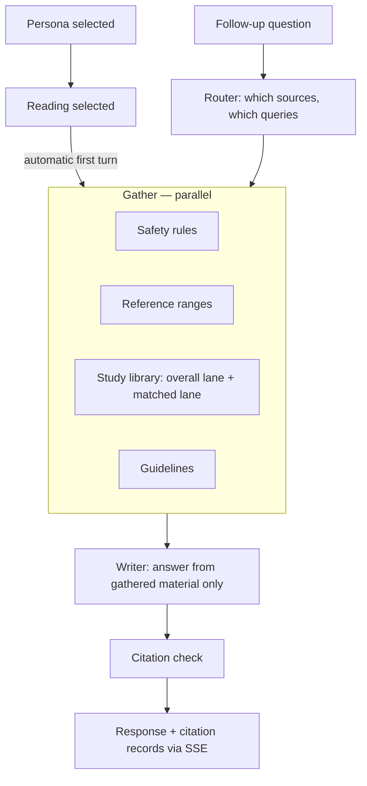

# pH Companion — Design

**Status:** Draft for review
**Created:** 2026-11-13
**Depends on:** [01-requirements.md](01-requirements.md)
**Next:** 03 Tasks (after this doc is agreed)

---

## 1. Summary

Three changes carry the design:

1. **Gather first, then write.** Today specialists and evidence retrieval run side by side, so the specialists write from model memory and citations are attached afterwards. In pH Companion, all sources are consulted first, and one writer composes the answer from that material only. This is what makes claim-level citations possible.
2. **Sources are explicit tools.** Each source is a named step with its own query, its own result, and its own line in the pipeline view, so the user sees what was looked up and when.
3. **Citations are data, not text.** The writer emits markers; the server validates them against what was retrieved and sends structured citation records; the UI renders them as tappable numbers.

## 2. What exists today and what changes

| Area | Today | pH Companion |
|---|---|---|
| Graph | router → specialists and evidence in parallel → synthesizer | router → sources in parallel → writer → citation check |
| LLM specialists | symptom, medication, lifestyle (answer from model memory) | Replaced by one grounded writer (see decision D1) |
| Evidence retrieval | One semantic top-5 query with the patient summary appended to the query text | Rewritten queries; profile applied through structured filters; two lanes |
| Corpus | Clinical guideline chunks, no study metadata | Study library with per-study records, plus guideline excerpts |
| Citations | `{source, tier, grade, text}`; sent to the browser but never rendered | Structured records, rendered inline and in a source list |
| Profile | `PatientProfile` parsed from FHIR/Synthea | `UserProfile` loaded from persona files |
| Drug interaction screening | OpenFDA label + FAERS pair screening | Removed from the graph (see section 4) |
| Pipeline view | Router badge, specialist badges, routing reasoning | Same component; badges are sources and show query and result counts |
| Mobile | One `max-width: 600px` block | Designed at 360px first |

## 3. Flow



- **Automatic first turn.** Selecting a reading sends a request marked as a new reading. The route is fixed (all four sources), so no router LLM call is needed and the first answer starts sooner.
- **Follow-up turns.** The router picks the sources and writes one to three short search queries. An off-topic question returns an empty route and the writer declines politely, as today.

## 4. Sources and tools

Each source is a function with a typed input and output, wrapped as a graph node. None of them calls an LLM.

| Source | What it answers | Backing data | In first version |
|---|---|---|---|
| **Safety rules** | Does this profile + reading + stated symptoms require a clinician recommendation? | Small rule table; each rule points to the guideline passage that justifies it | Yes |
| **Reference ranges** | What pH range is expected for a woman with this menopausal status, pregnancy status, cycle phase? | Curated table; each row points to a study passage | Yes |
| **Study library** | What do studies say about this question, overall and in cohorts like this woman? | Curated papers in Qdrant with structured study records | Yes — the core |
| **Guidelines** | What do professional bodies recommend? | Guideline excerpts in the same store, marked as guidelines | Yes |
| **Medication labels** | What does the official label say about a named medicine (for example an antibiotic or vaginal oestrogen)? | Existing OpenFDA label client | Optional (decision D4) |
| **Live literature search** | Is there anything on a topic the curated library does not cover? | Europe PMC or PubMed search API | Later (decision D2) |
| Drug pair interaction screening | — | OpenFDA FAERS | Dropped: not relevant to this domain |

Why reference ranges and safety rules are tables and not retrieval: these are the two places where a wrong answer does the most harm, so they should be deterministic, unit-testable, and reviewable line by line. The values themselves come from the corpus during curation; none are fixed in this document.

### 4.1 Study library retrieval

**Queries.** The profile is no longer pasted into the query text. The router (or the fixed first-turn template) produces short topical queries such as "vaginal pH after menopause". The profile is applied only through metadata.

**Two lanes, two searches:**

| Lane | Candidate set | Ranking | Places |
|---|---|---|---|
| Overall | All studies and guidelines | Semantic relevance × evidence weight (design, sample size) | Up to 4 |
| Matched | Studies whose cohort matches the profile on a distinguishing attribute | Cohort match score, subject to a minimum relevance | Up to 3 |

**Cohort match.** Computed from the study record against the profile:

- Ancestry: exact match scores highest; a broader group (Indian → South Asian) scores lower and is labelled as broader. The hierarchy stops there: a cohort described only as "Asian" does not count as a match for an Indian profile.
- Ancestry matches wherever the study was run. A study of women of Indian ancestry in India, Europe or North America all qualify for an Indian profile.
- Menopausal status, pregnancy status: match or no match.
- Age: profile age inside the cohort's range.
- Country of residence: minor weight, never required. The citation card shows where the study was run, so a match on ancestry but not on country is visible to the reader.

A study enters the matched lane only if it matches on ancestry, or on postmenopausal status for a postmenopausal profile, or on pregnancy for a pregnant profile. Matching only on "premenopausal adult" does not count, since that describes most studies.

**Guards:**

- The minimum relevance threshold stops an unrelated study from being surfaced just because the cohort matches.
- A study that appears in both lanes is shown once, in the matched group.
- If the matched lane is empty, the result carries an explicit `no_matched_evidence` flag naming the unmatched attributes; the writer must state the gap (requirement R6.4).

Weights and thresholds are tuned against the acceptance scenarios, not fixed here.

### 4.2 Corpus build

The source of truth is one checked file per study in the repository; the Qdrant store is a build output. Checking is done by a second LLM pass, not by a clinical expert (decided 2026-11-13); the record stores how it was checked so expert review can be added later.

```
candidate list (manual + search)
   → fetch title, abstract, identifiers (PubMed / Europe PMC)
   → LLM drafts the study record
   → second LLM pass checks the draft against the abstract
   → disagreements are corrected or the record is dropped
   → only checked records are indexed
```

- Target: 30–50 papers covering vaginal pH, bacterial vaginosis, vaginal microbiome, menopause-related changes, pregnancy. Coverage is planned per persona so each has at least two matched studies and at least one deliberate gap.
- Stored text: abstracts, plus full text where a paper is open access. No licence review for the demo; the licence reported by Europe PMC is copied onto the record.
- Guideline excerpts follow the same process.

## 5. Data model

### 5.1 `UserProfile` (replaces `PatientProfile` for this branch)

| Field | Notes |
|---|---|
| id, display name, age | |
| ancestry | Value from a small hierarchy (for example South Asian › Indian) |
| country of residence | |
| menopausal status | premenopausal, perimenopausal, postmenopausal |
| pregnancy | not pregnant, or trimester |
| cycle | regular or not, cycle day if known |
| hormonal contraception / HRT | type or none |
| recent antibiotics | yes/no, when |
| symptoms | list, may be empty |
| history | for example recurrent bacterial vaginosis |

Loaded from `src/data/personas/*.json`. The FHIR parser and Synthea bundles are not used on this branch.

### 5.2 `TestReading`

`ph` (float), `confidence` (0–1), `taken_at`. A handful of preset readings are selectable in the UI.

### 5.3 `StudyRecord`

| Group | Fields |
|---|---|
| Identity | study id, DOI, PubMed ID, URL, title, authors, year, journal |
| Design | design (meta-analysis, RCT, cohort, cross-sectional, case series, guideline), sample size |
| Cohort | ancestry list, countries, age range, menopausal status, pregnancy status |
| Content | topics, key findings (each tied to a passage) |
| Provenance | licence, text source (abstract or full text), check status, checked by (LLM pass or person), checked on |

Chunks in Qdrant carry the study id plus the cohort and design fields needed for filtering. `ChunkMetadata` is extended, not replaced.

### 5.4 `Citation` (sent to the browser)

| Field | Purpose |
|---|---|
| number | The marker shown in the text |
| group | overall, matched, guideline, reference range |
| title, authors (short), year | Display |
| design, sample size, cohort summary | Honest framing (R7.2) |
| matched attributes | For example "Indian ancestry, premenopausal" |
| passage | The exact retrieved text the claim rests on |
| url | Link to the paper |

### 5.5 State changes (`src/models/state.py`)

| Field | Change |
|---|---|
| `patient`, `patient_summary` | Kept under the same names; now hold the `UserProfile` and its summary |
| `reading` | New: the current `TestReading` |
| `turn_kind` | New: `new_reading` or `question` |
| `queries` | New: search queries from the router |
| `sources` | New, merged across parallel nodes: retrieved passages keyed by source key |
| `retrieval_trace` | New, appended: per source, the query run and counts found |
| `safety_reasons` | New, appended: which rules fired |
| `citations` | Same reducer, new record shape (5.4) |
| `evidence_context` | Replaced by `sources` |
| `drug_interactions` | Removed |
| `language` | Added to the TypedDict (the API already passes it) |

## 6. Writer and citation check

**Writer.** One LLM call. The prompt contains the profile summary, the reading, the fired safety rules, and the gathered passages, each with a stable key and a one-line description (design, sample size, cohort, lane). Instructions:

- Use only the supplied passages for claims about ranges, causes and risks, and mark each such claim with the passage key.
- State size and design in words when citing a small study.
- State the gap when the matched lane reports none.
- Keep the existing tone, brevity and safety rules from the current synthesizer prompt.

**Citation check.** Deterministic, runs after the writer:

1. Every marker must refer to a passage that was actually retrieved in this turn. Unknown markers are removed and logged.
2. Markers are renumbered 1, 2, 3 in order of first appearance.
3. Citation records are built for the markers that remain.
4. If the answer contains no valid marker on a turn where sources were retrieved, the turn is retried once, then flagged.

Whether every claim is cited (as opposed to every citation being valid) is judged in the evaluation suite, not at runtime.

## 7. Interface

### 7.1 Screen layout (phone first)

```
┌──────────────────────────────┐
│ pH Companion      [DE] [☀]   │
├──────────────────────────────┤
│ ‹ Priya 29 │ Anna 56 │ … ›   │  persona chips, swipe sideways
├──────────────────────────────┤
│ Priya · 29 · premenopausal ▾ │  profile card, collapsed by default
├──────────────────────────────┤
│ pH 4.8   read confidence 92% │  result card
│ ▁▁▁▂▂▃▅▇▅▃  today 08:14      │  scale with marker
├──────────────────────────────┤
│ ✓ Checked 4 sources · 6 studies ▾ │  pipeline, collapsed when done
│                              │
│ A reading of 4.8 is slightly │
│ above the range usually      │
│ reported for women before    │
│ menopause¹. A small study of │
│ women in India found …²      │
│                              │
│ Sources (4) ▾                │
├──────────────────────────────┤
│ [Ask about your result…] [➤] │
└──────────────────────────────┘
```

On a wide screen the same blocks sit in the current single centred column; nothing moves to a side panel.

### 7.2 Pipeline view: what was looked up

The existing pipeline card is kept. Specialist badges become source badges, and each gains a detail line fed by `retrieval_trace`:

```
✓ Deciding what to look up
✓ Safety rules        no urgent flags
✓ Reference ranges    premenopausal, not pregnant
● Study library       "vaginal pH premenopausal" · 6 found · 2 match your profile
● Guidelines          "elevated vaginal pH next steps"
○ Writing your answer
```

While running it is open; when the answer arrives it collapses to one line that can be reopened.

### 7.3 Citations

- **In the text:** small superscript numbers after the claim. Matched-cohort citations carry a subtle accent so "studies in women like you" are visible without reading the list.
- **On tap:** a card opens — a bottom sheet on a phone, a popover on a wide screen:

  ```
  ┌──────────────────────────────┐
  │ ² Studies in women like you  │
  │ Title of the paper           │
  │ Author et al., 2019          │
  │ Cross-sectional · 15 women   │
  │ Matches you: Indian ancestry │
  │                              │
  │ “…exact passage the claim    │
  │  is based on…”               │
  │                              │
  │ [Read the study ↗]           │
  └──────────────────────────────┘
  ```

  The quoted passage is what makes quick verification possible: the reader sees the supporting sentence without leaving the conversation, and can open the paper to read more.
- **Under each answer:** a collapsed "Sources (n)" line. Expanded, it lists the same cards in two groups — best overall evidence, and studies in women like you. There is no separate sources window (decision D3).
- **Safety:** when a rule fires, a banner sits above the answer text with the recommendation and its own citation.

### 7.4 Events to the browser

The existing SSE stream is kept. Changes:

| Event | Change |
|---|---|
| `specialist` | Carries `detail` (query, counts) for the pipeline line |
| `response` | Carries `citations` (records from 5.4) and `safety_reasons` |
| Request body | Adds `reading` and `turn_kind` |

New endpoints replace the patient ones: list personas, get persona, list preset readings.

## 8. Testing

| Layer | What is tested |
|---|---|
| Unit | Cohort match scoring, lane selection and guards, reference range lookup, safety rules, citation check |
| Corpus | Every indexed record is checked, has an identifier and a licence; matched-study coverage per persona is reported |
| Evaluation | Acceptance scenarios A1–A8 from the requirements, using the existing LLM judge for claim coverage and tone |

## 9. Decisions

| # | Decision | Outcome |
|---|---|---|
| D1 | Replace the three LLM specialists with one grounded writer? | **Yes** (2026-11-13). The story becomes "many sources, one careful writer". |
| D2 | Live literature search in the first version? | **No** (2026-11-13). Build a good curated corpus first and work with that. |
| D3 | Sources as a collapsible list under each answer plus a tap card, no separate window? | **Yes** (2026-11-13). |
| D4 | Medication labels (OpenFDA) in the first version? | **Left out** unless decided otherwise. Not part of the core story; the existing client stays in the repository unused. |

## 10. Risks

| Risk | Mitigation |
|---|---|
| Too few real studies exist for a persona's cohort | Found out in the corpus check. The persona stays; the gap is shown in the demo as a finding |
| A wrong sample size or cohort label is shown | Two independent LLM passes must agree; the passage is always shown next to the citation so the reader can check. Not expert-reviewed, and stated as such |
| Response time in a live demo | Fixed route on the first turn; sources are fast lookups; one writer call. Token streaming of the answer is a possible later improvement |
| Licence of stored text | Accepted for a demo: abstracts, short attributed quotes and links. Would need a review before a real product |
| Ethnicity handled clumsily | Used for evidence selection only; wording rules in the writer prompt; an evaluation case checks for it |
