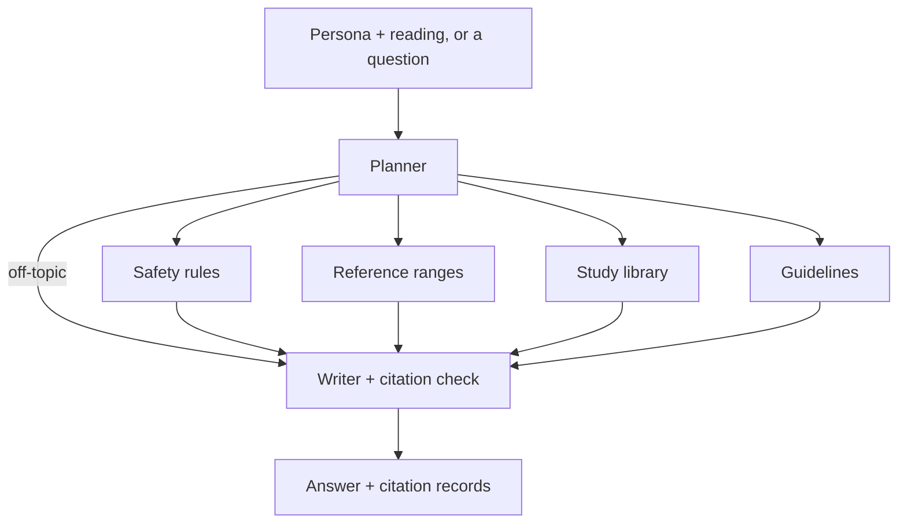

# System Overview — pH Companion

## One turn

| Step | Model call | What it does |
|---|---|---|
| Planner | Only for questions | Chooses sources, writes 1–3 search queries, flags off-topic |
| Safety rules | No | Evaluates `data/corpus/safety_rules.yaml` against profile and reading |
| Reference ranges | No | Looks up `data/corpus/reference_ranges.yaml` for her menopausal and pregnancy status |
| Study library | No | Semantic search, then two lanes: matched cohort and best overall |
| Guidelines | No | Same search, guideline records only |
| Writer | Yes | Writes from the gathered evidence; one retry if citations are missing |
| Citation check | No | Drops unknown markers, renumbers, builds citation records |

The safety check always runs for an on-topic turn. A new reading uses a fixed plan, so its first model call is the writer.

## Event stream (`POST /api/chat`)

| Event | Payload | Page effect |
|---|---|---|
| `routing` | `{status: "processing"}` | "Deciding what to look up" |
| `routing` | `{agents, queries, reasoning}` | One step per source |
| `specialist` | `{agent, status, detail: {query, counts}}` | Step done, with what was found |
| `synthesizing` | `{}` | "Writing your answer" |
| `response` | `{content, citations, safety_escalation, safety_reasons}` | Answer, citation numbers, safety notice |
| `done` | `{session_id}` | — |

Other endpoints: `GET /api/personas`, `GET /api/personas/{id}`, `GET /api/readings`, `GET /api/health`.

## Data

| What | Where | Notes |
|---|---|---|
| Study records | `data/corpus/studies/*.yaml` | Source of truth; `check.status` must be `checked` to be indexed |
| Reference ranges | `data/corpus/reference_ranges.yaml` | Each row quotes a study verbatim (tested) |
| Safety rules | `data/corpus/safety_rules.yaml` | Deterministic conditions with EN/DE messages |
| Search index | `src/knowledge_pipeline/study_store/` | Built from the records; one process at a time |
| Personas, readings | `src/data/personas/` | Three profiles, three preset readings |
